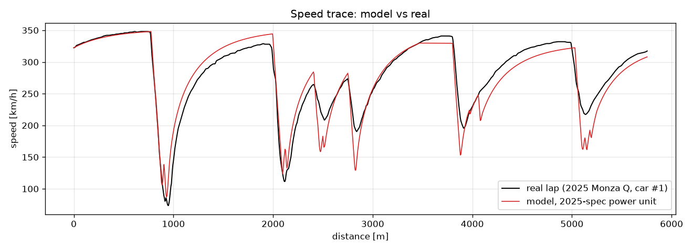
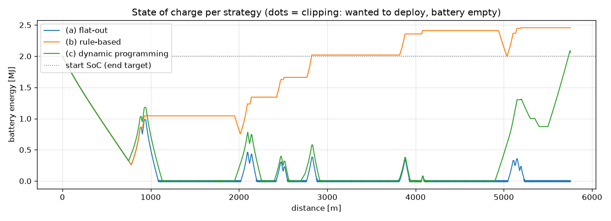
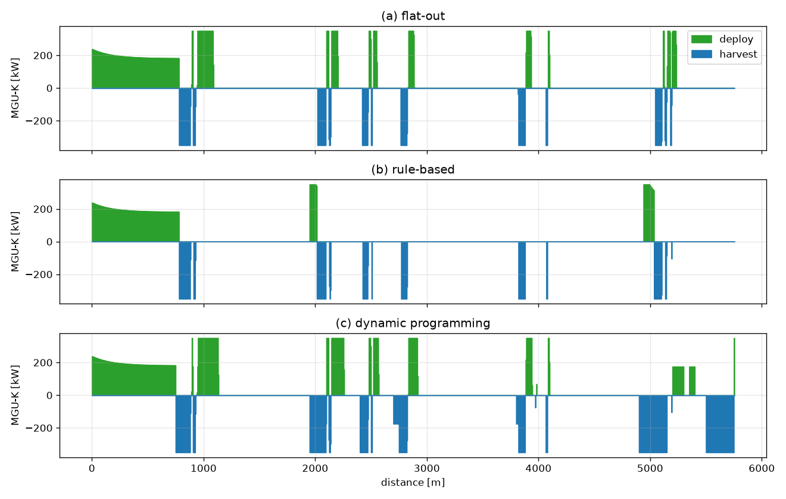

# Electrical energy deployment on a lap: a hybrid lap-time model

A small, self-built study of one question: **with a hybrid power unit where the electric
motor gives a large share of the power but the battery holds only a few megajoules, where on
the lap should you spend the energy, and where should you recover it?**

It uses a point-mass lap model on a real circuit (Monza, from a real 2025 qualifying lap),
a battery model, three deployment strategies including dynamic programming, a C++17 port of
the integrator, and tests.

> Personal portfolio project. Not affiliated with, endorsed by, or using data from any
> Formula 1 team, the FIA or Formula One Management. All car and power-unit parameters are
> rough approximations from public press reporting (sources below), **not** any team's values
> and not the exact regulation text.

## How it fits together

```
 OpenF1 API / FastF1  ──>  data/monza_lap.csv   (time, distance, x, y, speed of one real lap)
                                  │
                                  ▼
   src/model.py   track: x,y ─> curvature ─> cornering speed limit ─> braking envelope
                  car:   drag, rolling resistance, ICE power, grip, downforce
                  MGU-K: deploy limit (with high-speed taper), harvest limit
                  battery: energy window, per-lap harvest cap, efficiency
                  step(): one 5 m step   simulate(): one lap from a command cmd[i]
                                  │
              ┌───────────────────┼─────────────────────┐
              ▼                   ▼                     ▼
 src/strategies.py  (a) flat-out   (b) rule-based   (c) dynamic programming
              └───────────────────┼─────────────────────┘
                                  ▼
   src/run.py    validation vs real lap, strategy table, C++ vs Python check + timing
   src/report.py plots ──> results/*.png, results/summary.md

   cpp/lapsim.cpp  same simulate() in C++17  ──ctypes──>  src/cpp_lapsim.py
   cpp/test_lapsim.cpp, tests/test_model.py   unit and physics tests
```

## How to run

Needs Python 3.10+ (uv recommended), a C++17 compiler and make.

```
make data     # create .venv, download the lap (already committed as data/monza_lap.csv)
make build    # build/liblapsim.so and build/test_lapsim
make test     # C++ unit tests + pytest (10 tests)
make run      # validation + strategies + C++ benchmark, writes results/summary.md
make report   # run + plots in results/
make clean
```

`make run` takes about 8 s on a laptop, single-threaded (most of it is the calibration grid search).

## Results (real numbers from `make run`, 2026-11-18)

### 1. Model vs the real lap

A 2025-spec version of the car (560 kW engine + 120 kW MGU-K, as publicly reported) is run on
the track and compared with the real lap. Two numbers were fitted to this lap by grid search:
tyre grip `mu = 1.80` and drag area `CdA = 1.20 m²`.

| metric | value |
|---|---|
| real lap time | 78.792 s |
| model lap time | 78.819 s (+0.027 s) |
| speed RMSE | 19.6 km/h |
| mean speed error | -2.5 km/h |
| worst speed error | 67 km/h |
| top speed real / model | 348 / 348 km/h |
| slowest point real / model | 74 / 87 km/h |



Read this honestly: the lap time match is **by construction** (the two parameters were fitted to
it, and it is the same lap), so it is not evidence of predictive accuracy. The 19.6 km/h RMSE
is the real measure of the gap. Most of it comes from corners: the corner speed limit is
computed from the curvature of position data sampled at about 3.7 Hz (one point every ~20 m at
speed), so chicanes come out with the wrong shape (the double dips in the plot) and the model
accelerates out of slow corners faster than the real car (no wheelspin, no gearshifts, no
tyre model). Straights and top speed match well.

### 2. Deployment strategies (2026-style power unit)

Same chassis, now with a 400 kW engine, a 350 kW MGU-K with a high-speed deploy taper, a 4 MJ
battery window, 8.5 MJ per lap harvest cap. The lap starts at 2.0 MJ. A strategy is
**charge-sustaining** if it ends the lap with at least 2.0 MJ, so it could repeat the lap.

| strategy | lap time | vs DP | deployed | harvested | end SoC | clipping |
|---|---|---|---|---|---|---|
| (a) flat-out | 83.393 s | +0.050 s | 4.87 MJ | 3.29 MJ | **0.00 MJ** | **3905 m** |
| (b) rule-based (deploy above 288 km/h) | 86.048 s | +2.705 s | 2.32 MJ | 3.05 MJ | 2.46 MJ | 0 m |
| (c) dynamic programming | **83.343 s** | 0 | 5.55 MJ | 6.21 MJ | 2.06 MJ | 355 m |

"Clipping" = distance where the strategy wanted to deploy but the battery was empty.

- **Flat-out** empties the battery by 1100 m and then runs 3.9 km (68% of the lap) with nothing
  left to deploy. It also ends the lap 2.0 MJ short, so the next lap would be much slower.
- **DP is 0.050 s faster than flat-out while ending the lap with *more* energy than it started
  with** (2.06 vs 2.00 MJ). It does this by harvesting with the engine at the end of the long
  straights, where the deploy taper makes the MGU-K weak anyway and where drag eats most of the
  power, and spending that energy out of slow corners where each joule buys the most time.
  Clipping drops from 3905 m to 355 m.
- **The speed-threshold rule is 2.7 s slower.** The 2026-style car only goes above ~290 km/h
  without help on the main straight, so a rule "deploy above X" either drains the battery
  (X ≤ 286 km/h) or barely deploys at all (X ≥ 288 km/h). A single speed threshold is too
  coarse a knob for this power unit. It ends with 0.46 MJ unused.




### 3. C++ core

`cpp/lapsim.cpp` is a line-by-line port of `model.simulate()` (braking envelope + forward
integration), called from Python through ctypes.

| | result |
|---|---|
| max lap time difference, Python vs C++ (3 strategies) | < 1e-6 s (prints identical to 6 decimals) |
| max speed difference | 1e-13 m/s |
| one lap, Python | 19.1 ms |
| one lap, C++ (including the ctypes call) | 67 µs |
| speedup | **~284x** |

The DP does not use the C++ core: it calls the Python `step()` on all live states at once
(up to 405 states vectorised with numpy), which already takes only about 0.04 s. The C++ core would pay off
where many single laps run one after another, e.g. the rule-based threshold sweep or a
parameter sweep; those still use the Python path today.

## How the dynamic programming works (short version)

- The lap is cut into 50 m segments (116 stages).
- State: battery energy, in 81 bins of 50 kJ.
- Decision per segment: MGU-K command of -100%, -50%, 0, +50% or +100% (negative = harvest
  using the engine).
- Cost: time to drive the segment, found by actually simulating it.
- Terminal constraint: end energy ≥ start energy.
- Each bin keeps only its fastest path (and that path's exact speed). Speed is really a second
  state, so this is an approximation, not a guaranteed global optimum. The DP's predicted lap
  time is checked to equal a full re-simulation of the chosen plan (it does: 83.343 s).

## Parameters and sources

| parameter | value used | basis |
|---|---|---|
| MGU-K deploy / harvest | 350 kW / 350 kW | widely reported 2026 figure [1][2][3] |
| ICE power | 400 kW | approx., from the reported ~50/50 ICE/electric split [3][4] |
| harvest per lap | 8.5 MJ | reported 2026 figure [1][2] |
| deploy taper | 1850 − 5·v(km/h) kW, 150 kW floor above 340 km/h | as reported for the 2026 PU rules sign-off [5]; reportedly changed later, treat as illustrative |
| battery usable window | 4 MJ | **my assumption**, not sourced |
| car mass | 768 kg + 30 kg fuel | 768 kg minimum reported [6] |
| electrical efficiency | 0.95 each way | assumption |
| grip, drag area | 1.80, 1.20 m² | fitted to the real 2025 lap |
| downforce area | 3.5 m² | assumption (low-downforce track) |
| 2025 comparison car | 560 kW + 120 kW, 828 kg | commonly reported 2025-era figures |

1. The Race, "F1 2026's new engine rules explained": https://www.the-race.com/formula-1/f1-2026-new-power-unit-engine-rules-explained/
2. Motorsport Magazine, "All the key aspects changing on F1's 2026 engines": https://www.motorsportmagazine.com/articles/single-seaters/f1/all-the-key-aspects-changing-on-f1s-2026-engines
3. Formula1.com, "7 things you need to know about the 2026 F1 engine regulations": https://www.formula1.com/en/latest/article/more-efficient-less-fuel-and-carbon-net-zero-7-things-you-need-to-know-about.ZhtzvU3cPCv8QO7jtFxQR
4. Motorsport Magazine, "Inside F1's 2026 tech revolution": https://www.motorsportmagazine.com/special-article/f1-26-new-season-guide/6/inside-f1s-2026-tech-revolution-active-aero-50-50-hybrid-power-and-lighter-cars
5. PMW Magazine, "FIA signs off 2026 F1 PU rules": https://pmw-magazine.com/news/race-series-news/fia-signs-off-2026-f1-pu-rules-with-mgu-h-dropped-and-tight-constraints-on-ice-design.html
6. Motorsport Magazine, "How the F1 chassis is changing under 2026 regulations": https://www.motorsportmagazine.com/articles/single-seaters/f1/how-the-f1-chassis-is-changing-under-2026-regulations

Lap data: [OpenF1](https://openf1.org) public API (2025 Italian GP qualifying, car #1, 78.792 s).
FastF1 is tried first, but F1 live-timing now returns HTTP 401 without an account (see BUGS.md).

## Limitations

- **Point mass.** No load transfer, no suspension, no combined braking-and-cornering; corners
  are a speed cap from curvature.
- **Approximate parameters.** See the table. Results show *relative* differences between
  strategies on this model, not real lap times for a 2026 car.
- **No tyres or thermal.** No tyre model, no tyre or battery temperature, no battery
  resistance or SoC-dependent limits, constant efficiency.
- **No active aero.** 2026 cars switch to a low-drag mode on straights; here drag is constant.
- **One lap, same lap for fitting and checking.** Validation is in-sample.
- **Coarse curvature** from ~3.7 Hz position data; the main source of speed error.
- **Explicit integrator** with 5 m steps: about 0.4% speed error over a 1 km coast-down,
  measured against the exact solution (test in `cpp/test_lapsim.cpp`).
- **DP approximation**: speed is not a gridded state, and only 5 command levels per 50 m.
- **Fuel energy is not limited** (2026 rules also cap fuel energy flow); the engine always
  gives 400 kW at full throttle.

## Layout

```
src/fetch_data.py   get the lap          src/model.py        physics + battery
src/strategies.py   (a) (b) (c)          src/cpp_lapsim.py   ctypes wrapper
src/run.py          all numbers          src/report.py       plots
cpp/                C++17 core + tests   tests/              pytest
results/            summary.md + plots   INTERVIEW_NOTES.md, BUGS.md
```
